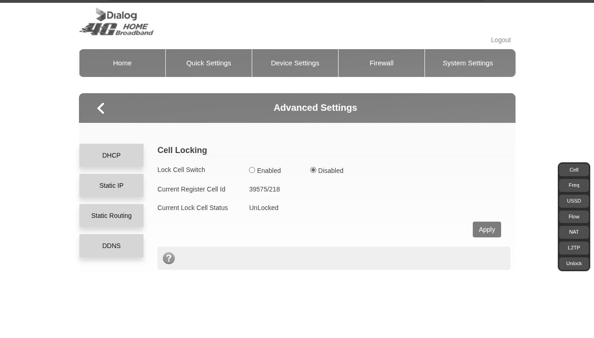

# ZLT P11H Router Tools | For Dialog Axiata Modified Firmware

A lightweight Chrome extension that adds an in-page navigation toolbar to the Dialog ZLT/P11 router web interface.

Some ISPs hide or block direct access to certain router settings pages. This extension restores quick access using the router's own internal navigation API.

---

## ✨ Features

- **Adds a clean, floating toolbar** directly inside the router interface
- **One-click access** to pages such as:
  - Cell Locking
  - Frequency Lock
  - USSD
  - Flow / QoS settings
  - NAT
  - L2TP
  - Unlock page (if supported)
- **No redirects** to external servers
- **No modification** to router firmware or backend
- Works only on `http://192.168.8.1` (ZLT/P11 default UI)

---

## 🧩 Why This Exists

Some Dialog/ISP firmware versions hide or block UI pages that still exist internally on the router. The router accepts a special backend command:

```
/reqproc/proc_get?cmd=set_hash&hash=<page>
```

This extension simply exposes those pages again by creating UI buttons that send the correct command.

---

## 📦 Installation (Manual)

Because this is a local extension, you can install it manually on Chrome or Firefox.

### Chrome / Chromium / Edge / Brave
1. **Download or clone** this repository
2. Open your browser and go to `chrome://extensions/` (or equivalent for your browser)
3. Enable **Developer mode** (top-right toggle)
4. Click **Load unpacked**
5. Select the folder containing `manifest.json`

### Firefox
1. **Download or clone** this repository
2. Open Firefox and go to `44
3. Click **Load Temporary Add-on...**
4. Select the `manifest.json` file inside the downloaded folder

## 💡 How to Use

1. Log in to your router at `192.168.8.1`
2. After login, the toolbar appears on the right side
3. Click any button:
   - **Cell** → Cell Lock Page
   - **Freq** → Frequency Lock
   - **USSD** → USSD Page
   - **Flow** → Flow/QoS
   - **NAT** → NAT Settings
   - **L2TP** → L2TP Tunnel Settings
   - **Unlock** → Unlock Page (if firmware supports it)

### The extension does NOT:

- Save passwords
- Store cookies
- Inject scripts into non-router sites
- Send data externally

---

## 🔒 Security & Safety

- Code runs **only** on `http://192.168.8.1/*`
- No permissions beyond basic DOM injection
- No network activity other than the router's own API
- No analytics or tracking
- **Fully open-source**

---

## 🛠 Compatibility

Tested on:

- **ZLT/P11 routers**
- **Chrome, Chromium, Brave, Edge** (Chromium-based)
- **Mozilla Firefox** (v109+)
- **Dialog ISP firmware** (others may work)

## 🧵 Extra

CLI Tool

A **Bash CLI toolkit** for automating router operations via command line. Especially useful in low signal areas where cell towers frequently change, causing disconnections and unstable connections.(so you don't have to manually login to the WebUI every time the cell changes)

### Usage:
```bash
cd cli/
chmod +x p11h.sh
./p11h.sh
```

> **Requirements:** `curl` and basic Unix tools. Tested on Linux.

---

## 📄 License

This project is open-source. Feel free to fork, modify, and distribute.

---

## 🤝 Contributing

Found a bug or want to add a feature? Pull requests are welcome!

---

## ⚠️ Disclaimer

This extension is provided as-is with no warranty. Use at your own risk. The author is not responsible for any damage to your router or network configuration.

